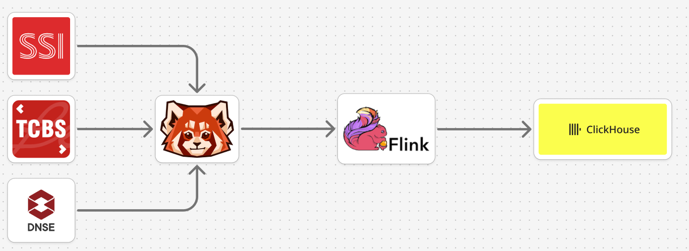

# vn-trading-market-data

Real-time Vietnamese equity market data collected from **SSI**, **DNSE** and
**TCBS** over WebSocket, published to **Kafka**, parsed by **Flink**, and
batch-inserted into queryable tables in **ClickHouse**.



Payloads reach Kafka verbatim across 5 raw topics. A Flink job routes and parses
them, then batch-inserts them (AT_LEAST_ONCE, append-only) into 8 unified
ClickHouse tables.

---

## Getting started

```bash
make init          # network + data directories (once)
$EDITOR src/ingestion/.env      # fill in credentials
make up            # bring everything up in dependency order
make status        # which feeds are alive, and how long they have been quiet
```

`make test` runs **at any time** — no docker, no open market required.

No credentials, or the market is closed? The whole pipeline also runs against a
**broker simulator** that speaks the SSI, DNSE and TCBS protocols:

```bash
docker compose -f environment/e2e/docker-compose.yml up -d --build
docker compose -f environment/e2e/docker-compose.yml run --rm e2e-check   # nothing lost?
```

See [`environment/e2e/`](environment/e2e/) and [`src/simulator/`](src/simulator/).

---

## Layout

| Directory | Contents |
|---|---|
| [`docs/`](docs/) | Vendor documentation for all three brokers: `details/` verbatim copies, `brief/DOCUMENT.md` a distilled WebSocket reference |
| [`environment/dev/`](environment/dev/) | Local infrastructure: kafka · clickhouse · flink · observability |
| [`environment/prod/`](environment/prod/) | Hardened production variants |
| [`environment/e2e/`](environment/e2e/) | Self-contained end-to-end stack fed by the simulator (≤ 20 GB RAM) |
| [`src/ingestion/`](src/ingestion/) | WebSocket → Kafka service (Python) |
| [`src/transform/`](src/transform/) | Kafka → Flink → ClickHouse: the Flink job (Java) plus the ClickHouse schema (SQL) |
| [`src/simulator/`](src/simulator/) | SSI / DNSE / TCBS WebSocket simulators, faithful to the docs and to the TCBS production audit |
| [`examples/`](examples/) | An older pipeline kept for reference — **not** the running code |

---

## Four decisions that shape everything

**1. Ingestion never transforms the payload.** Kafka receives exactly the bytes
the broker sent; metadata travels separately in headers (`source`, `feed`,
`wire_code`, `recv_ts_ns`). A wrong parser is fixed by dropping the target tables
and replaying from Kafka. Had ingestion transformed the data, the original would
be gone forever.

**2. Invariant engine, brokers as strategies.** `src/ingestion/core/` must not
know that SSI/DNSE/TCBS exist — it only knows `FeedSpec`, a contract with exactly
five methods. The acceptance criterion: **adding a fourth broker changes no line
in `core/`**. A test proves it using an entirely invented broker.

**3. Whatever a vendor leaves unspecified becomes a parameter, never a silent
guess.** The SSI documentation never states how the token reaches the socket, so
all three plausible mechanisms are implemented and selected by `SSI_AUTH_MODE`.
Changing one environment variable settles it; no code change.

**4. Never discard data we do not understand.** Unrecognised frames still reach
Kafka and still land in the `unknown_frames` table, with a counter driving an
alert. It was the absence of exactly this that let TCBS channel `s|42` — ~94% of
derivatives traffic — go unnoticed.

---

## Three facts about the data that drove the design

**No broker provides a sequence number.** Lost messages during a disconnect are
undetectable. Message identity is therefore
`(kafka_topic, partition, offset)` — never a timestamp.

**Exchange timestamps are wildly uneven.** DNSE gives nanoseconds; TCBS ouranos
gives seconds; SSI gives a second-resolution string; **the TCBS price-board family
gives nothing at all**. So `recv_ts` — stamped by us on arrival — is the only
value comparable across all three, while `exchange_ts` is allowed to be `NULL`
and the schema says so honestly.

**The same field is a string on one broker and a number on another.** TCBS cash
returns `"matchPrice":"24550"` while its derivatives feed returns `1870.5`; DNSE
returns numbers except `"volume":"12"`. Every numeric field is read through the
Flink job's `Json.num()` helper.

---

## Verification status

| Area | Status |
|---|---|
| Ingestion: config, framing, backoff, health | **61 tests passing** |
| Ingestion: all three protocols over a real socket | **passing** — the fake DNSE server recomputes and verifies the HMAC |
| Ingestion against the broker simulator | **passing** — every auth mode, json + msgpack, failure paths, disconnects not consuming the retry budget (`src/simulator/tests`) |
| Transform: Flink parsing and routing | **passing** — verbatim doc payloads, every emitted row checked against the DDL (`make transform-test`) |
| Whole pipeline in Docker (`environment/e2e`) | **passing** — simulator → ingestion → Redpanda → Flink → ClickHouse, every delivered frame accounted for, also with a connection dropped per broker every 15 s |
| Against the real brokers | **not yet** — the three open questions below still need a live connection |

Unblocking the remainder: `sudo usermod -aG docker $USER`, then log back in.

---

## Three questions only a live connection can answer

All three are already parameterised, so answering them means changing an
environment variable:

1. **How does SSI pass the token when opening the socket?**
   (`SSI_AUTH_MODE=query|header|frame`)
2. **Does DNSE count `subscriptions_max` per channel or per (channel × symbol)?**
   If the latter, 100 is far too few for 1600 symbols and `DNSE_SHARD_COUNT` must
   grow.
3. **What values does DNSE's `T` field take?** The transform routes by payload
   shape so it does not depend on the answer, but knowing would simplify it.

Details in `docs/<broker>/brief/DOCUMENT.md`, section "open questions".
